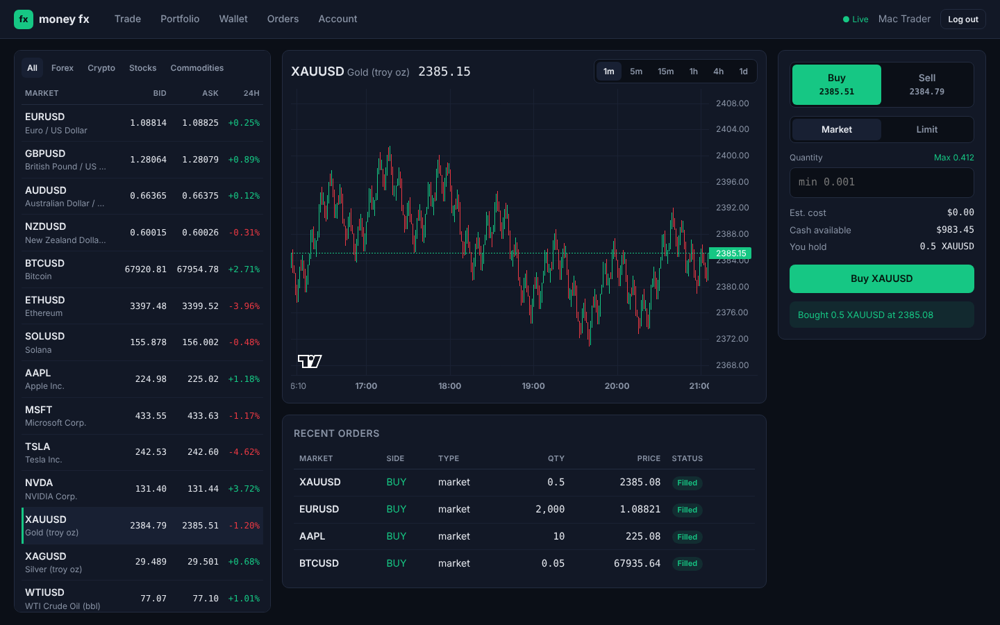

# money fx

A multi-asset trading platform: forex, crypto, stocks and commodities in one USD account.
Python (FastAPI + SQLAlchemy) backend, React (Vite) frontend, mock real-time market data.

Core flow working end to end: **sign up → deposit → place order → view portfolio**.



## Run it locally

Requirements: Python 3.11+ and Node 20+.

```bash
# 1. API on http://localhost:8000 (docs at /docs)
cd backend
python -m venv .venv && source .venv/bin/activate   # Windows: .venv\Scripts\activate
pip install -r requirements.txt
uvicorn app.main:app --reload

# 2. Web app on http://localhost:5173 (in a second terminal)
cd frontend
npm install
npm run dev
```

Open http://localhost:5173, create an account, deposit demo funds on the Wallet page, and trade.

Run the backend tests with `cd backend && pytest`.

## Features

| Area | What works now |
|---|---|
| Accounts | Sign up, log in (JWT), profile edit, change password, account status |
| Wallet | USD wallet, simulated deposits and withdrawals (card, bank, mobile money, crypto), full transaction ledger, cash reserved by open orders |
| Markets | 14 instruments: EUR/USD, GBP/USD, AUD/USD, NZD/USD, BTC, ETH, SOL, AAPL, MSFT, TSLA, NVDA, gold, silver, WTI oil |
| Charts | Candlestick charts (1m to 1d) with live updates over WebSocket |
| Orders | Market and limit orders, buy and sell, bid/ask spread, cancel open orders, rejections with reasons |
| Portfolio | Holdings, average price, live value, unrealized and realized P&L, total return, allocation by asset class |

## API

| Method | Path | |
|---|---|---|
| POST | `/api/auth/register`, `/api/auth/login` | Returns a bearer token |
| GET / PATCH | `/api/auth/me` | Profile |
| POST | `/api/auth/change-password` | |
| GET | `/api/wallet`, `/api/wallet/transactions` | |
| POST | `/api/wallet/deposit`, `/api/wallet/withdraw` | `{amount, method}` |
| GET | `/api/markets/instruments`, `/api/markets/quotes`, `/api/markets/candles/{symbol}?interval=1m` | |
| WS | `/api/markets/ws` | Pushes all quotes every second |
| POST / GET | `/api/orders` | `{symbol, side, type, quantity, limit_price?}` |
| DELETE | `/api/orders/{id}` | Cancel an open order |
| GET | `/api/portfolio` | |

## Project layout

```
backend/
  app/
    main.py        app setup, instrument seeding, limit-order matcher
    models.py      database schema (see docs/schema.md)
    market.py      mock price feed (swap for a live provider)
    trading.py     order execution and position accounting
    routers/       auth, wallet, markets, orders, portfolio
  tests/           end-to-end API tests
frontend/
  src/
    pages/         Trade, Portfolio, Wallet, Orders, Account, Auth
    components/    MarketList, PriceChart, OrderTicket, Layout
docs/schema.md     schema and trading rules
```

## Configuration

| Env var | Default |
|---|---|
| `MONEYFX_DATABASE_URL` | `sqlite:///./moneyfx.db` |
| `MONEYFX_SECRET_KEY` | `dev-secret-change-me` (**change in any shared deployment**) |
| `MONEYFX_TOKEN_MINUTES` | `720` |
| `MONEYFX_CORS_ORIGINS` | `http://localhost:5173` |

## Not built yet

This is a demo: no real money moves and prices are simulated. Before real users you need a
live price feed, a payment provider, KYC, and the security work listed in [docs/roadmap.md](docs/roadmap.md).
