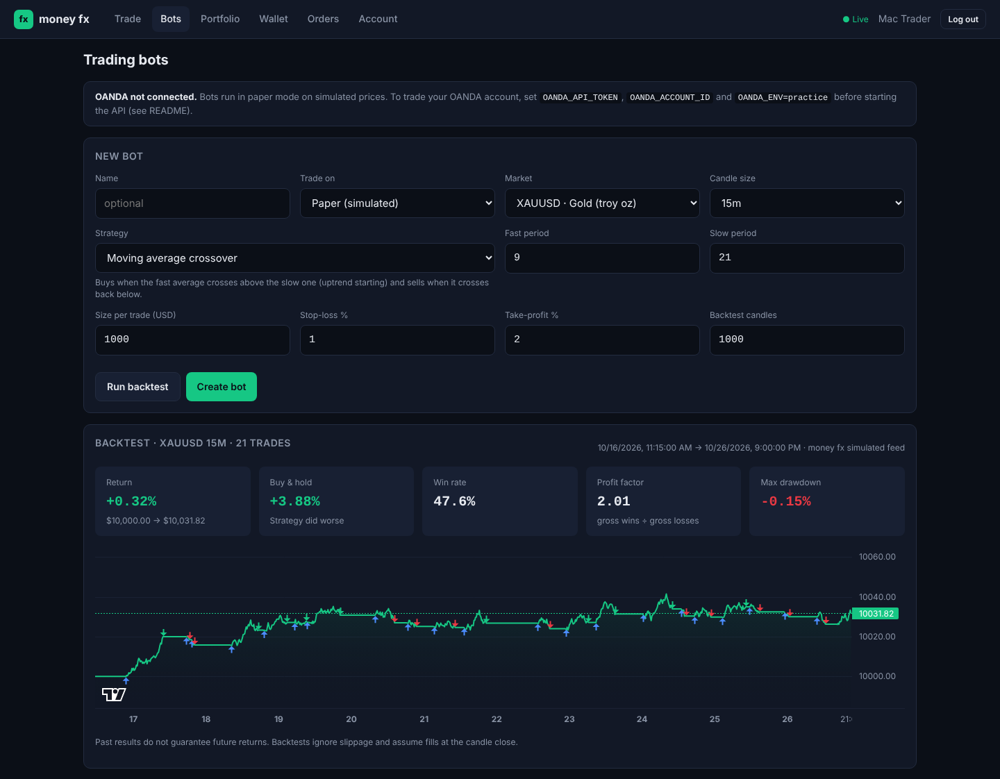

# money fx

A multi-asset trading platform and trading bot: forex, crypto, stocks and commodities.
Python (FastAPI + SQLAlchemy) backend, React (Vite) frontend, simulated real-time market data,
and automated bots that paper trade or trade your own **OANDA** account.

- Manual trading: **sign up → deposit → place order → view portfolio**
- Bots: **pick a strategy → backtest it → start it → it trades by itself with stop-loss and take-profit**



## Run it locally

Requirements: Python 3.11+ and Node 20+.

```bash
# 1. API on http://localhost:8000 (docs at /docs)
cd backend
python -m venv .venv && source .venv/bin/activate   # Windows: .venv\Scripts\activate
pip install -r requirements.txt
uvicorn app.main:app --reload

# 2. Web app on http://localhost:5173 (in a second terminal)
cd frontend
npm install
npm run dev
```

Open http://localhost:5173, create an account, deposit demo funds on the Wallet page, and trade.

Run the backend tests with `cd backend && pytest`.

## Browser demo

`cd frontend && npm run build:demo` builds a self-contained demo, `frontend/dist-demo/money-fx-demo.html`.
It runs the whole API inside the page (`frontend/src/demo/`), so it needs no server: simulated prices,
$10,000 of fake money, paper trading and bots (which run only while the page is open). No OANDA.

## Deploy (publish it online)

The repo includes a `Dockerfile` that builds the React app and serves it together with the API
from one container, and a `render.yaml` blueprint for one-click hosting on Render:

[](https://render.com/deploy?repo=https://github.com/mubeakungu/money-fx)

1. Click the button and sign in to Render with GitHub.
2. Fill in the OANDA values when asked (leave them blank to run paper-only).
   Set `OANDA_OWNER_EMAILS` to the email you will sign up with.
3. Render creates two services and gives each a public URL:
   - **money-fx**: the full app with bots and OANDA, at `https://money-fx-xxxx.onrender.com`
   - **money-fx-demo**: the browser demo anyone can try, at `https://money-fx-demo-xxxx.onrender.com` (free static site)

The blueprint uses Render's Starter plan (about $7/month) because the bot must run 24/7 and the
SQLite database needs a persistent disk. On the free plan the service sleeps when idle, so bots
stop trading, and the data is wiped on every deploy.

Any other Docker host works too (Railway, Fly.io, a VPS):

```bash
docker build -t money-fx .
docker run -p 8000:8000 -v moneyfx-data:/data \
  -e MONEYFX_ENV=production -e MONEYFX_SECRET_KEY=$(openssl rand -hex 32) \
  -e OANDA_API_TOKEN=... -e OANDA_ACCOUNT_ID=... -e OANDA_OWNER_EMAILS=you@example.com \
  money-fx
```

Run exactly one instance: the bot runner and the SQLite database live inside the container.

**Who can do what on a public deployment.** Anyone can sign up and paper trade with fake money.
Only the emails in `OANDA_OWNER_EMAILS` can see the OANDA account or create OANDA bots. If it is
empty, nobody can. The server refuses to start in production without `MONEYFX_SECRET_KEY`.

## Demo and Real accounts

When OANDA is connected and you are logged in as an owner (`OANDA_OWNER_EMAILS`), the top bar shows a
**Demo / Real** switch:

- **Demo**: the money fx simulated account with fake money (everything described above).
- **Real**: your OANDA account. Trade by hand on OANDA prices and charts, buy or sell short, attach a
  stop-loss and take-profit, and confirm every order in a second step. Portfolio, Orders and Wallet show your
  OANDA balance, open positions (with Close buttons), pending limit orders and closed trades. Positions
  opened by your bots show the bot's name. Deposits and withdrawals happen on OANDA itself.

A blue bar means OANDA practice; it turns red when `OANDA_ENV=live` and orders use real money.

To try the Real side without an OANDA login, run the fake OANDA server used by the tests:

```bash
cd backend
uvicorn tests.fake_oanda:app --port 8099 &
OANDA_BASE_URL=http://localhost:8099 OANDA_API_TOKEN=x OANDA_ACCOUNT_ID=001 \
  OANDA_OWNER_EMAILS=you@example.com uvicorn app.main:app
```

## Trading bots

Open the **Bots** page. Each bot trades one market with one strategy, holding at most one
position at a time:

| Strategy | Buys when | Sells when |
|---|---|---|
| Moving average crossover | the fast average crosses above the slow one | it crosses back below |
| RSI mean reversion | RSI climbs back above the oversold level | RSI falls back below the overbought level |
| Channel breakout | price closes above the highest high of the last N candles | price closes below the lowest low |

Every bot also has:
- **Trades**: *Buy only*, *Sell short only* (profits when price falls), or *Both ways* (each signal
  closes the current trade and opens the opposite one).
- **Stop-loss %** and **take-profit %** (optional). For a short they sit above and below the entry.
- **Sizing**: a fixed USD amount per trade, or *Risk % of balance*. With risk sizing the bot sizes each
  trade so that hitting the stop-loss loses about that % of your balance
  (size = balance × risk % ÷ stop-loss %), never more than the max size you set.

The **daily loss limit** at the top of the Bots page covers all your bots. Once their closed trades lose
that much in a day (UTC), they stop opening new trades until midnight; open trades keep their stops.
On paper, a short reserves its full value from your cash (shown as Reserved in the Wallet) and
settles its profit or loss when it closes.

1. **Backtest first.** "Run backtest" replays the strategy over past candles and shows return,
   win rate, profit factor, max drawdown and an equity curve, compared with simply buying and holding.
2. **Paper trade.** Create the bot with "Trade on: Paper". It trades your money fx demo balance
   on simulated prices. Check its trades and activity log on the bot's page.
3. **OANDA practice, then live.** Connect OANDA (below) and pick "Trade on: OANDA". Stop-loss and
   take-profit are attached to each OANDA order, so OANDA enforces them even if your computer
   or this server is off.

The bot checks once per closed candle (it never acts on a half-formed candle) and watches stops
every 2 seconds. If a bot hits 5 errors in a row (for example not enough funds), it stops itself.

### Connect OANDA

1. Open a free **practice** account at oanda.com (fxTrade Practice).
2. In the OANDA hub go to *Manage API Access* and generate a personal access token.
3. Find your v20 account ID (looks like `101-004-1234567-001`).
4. Start the API with those values set:

```bash
export OANDA_API_TOKEN=your-token
export OANDA_ACCOUNT_ID=101-004-1234567-001
export OANDA_ENV=practice          # change to "live" only when you are ready for real money
export OANDA_OWNER_EMAILS=you@example.com   # the money fx login allowed to use OANDA
uvicorn app.main:app
```

The Bots page shows a green "OANDA practice connected" banner with your balance when it works.
OANDA bots can trade EUR/USD, GBP/USD, AUD/USD, NZD/USD, gold (XAU), silver (XAG) and WTI oil;
which ones your account can actually trade depends on your OANDA region. Backtests on an OANDA
bot use OANDA's real historical candles.

Notes for live use:
- Keep the token secret. It can place trades on your account.
- The trade size is in USD and converted to units at the current price. P&L shown for OANDA
  trades is in your OANDA account currency.
- For risk sizing on OANDA the balance used is your account NAV.
- A strategy that wins on simulated prices proves nothing. The simulated feed is a random walk.
  Judge a strategy on OANDA data and a few weeks of practice trading before going live.

## Features

| Area | What works now |
|---|---|
| Accounts | Sign up, log in (JWT), profile edit, change password, account status |
| Wallet | USD wallet, simulated deposits and withdrawals (card, bank, mobile money, crypto), full transaction ledger, cash reserved by open orders |
| Markets | 14 instruments: EUR/USD, GBP/USD, AUD/USD, NZD/USD, BTC, ETH, SOL, AAPL, MSFT, TSLA, NVDA, gold, silver, WTI oil |
| Charts | Candlestick charts (1m to 1d) with live updates over WebSocket |
| Orders | Market and limit orders, buy and sell, bid/ask spread, cancel open orders, rejections with reasons |
| Bots | 3 strategies, long/short/both, backtester, paper and OANDA execution, stop-loss/take-profit, risk-based sizing, daily loss limit, per-bot P&L, trade history and activity log |
| Portfolio | Holdings, average price, live value, unrealized and realized P&L, total return, allocation by asset class |

## API

| Method | Path | |
|---|---|---|
| POST | `/api/auth/register`, `/api/auth/login` | Returns a bearer token |
| GET / PATCH | `/api/auth/me` | Profile |
| POST | `/api/auth/change-password` | |
| GET | `/api/wallet`, `/api/wallet/transactions` | |
| POST | `/api/wallet/deposit`, `/api/wallet/withdraw` | `{amount, method}` |
| GET | `/api/markets/instruments`, `/api/markets/quotes`, `/api/markets/candles/{symbol}?interval=1m` | |
| WS | `/api/markets/ws` | Pushes all quotes every second |
| POST / GET | `/api/orders` | `{symbol, side, type, quantity, limit_price?}` |
| DELETE | `/api/orders/{id}` | Cancel an open order |
| GET | `/api/portfolio` | |
| GET | `/api/bots/strategies`, `/api/bots/brokers` | Strategy list, OANDA connection status |
| POST | `/api/bots/backtest` | Strategy config plus `bars`, `capital` |
| GET / PUT | `/api/bots/settings` | Daily loss limit for all bots, and today's bot P&L |
| GET | `/api/real/account`, `/api/real/instruments`, `/api/real/prices`, `/api/real/candles/{symbol}` | Real (OANDA) account, owner only |
| GET / POST | `/api/real/orders`, `DELETE /api/real/orders/{id}` | Pending orders, place market/limit order, cancel |
| GET | `/api/real/trades?state=open\|closed`, `POST /api/real/trades/{id}/close` | Positions and history |
| GET / POST | `/api/bots` | List or create bots |
| GET / DELETE | `/api/bots/{id}` | Bot with trades and activity log |
| POST | `/api/bots/{id}/start`, `/stop`, `/close-position` | |

## Project layout

```
backend/
  app/
    main.py        app setup, instrument seeding, limit-order matcher
    models.py      database schema (see docs/schema.md)
    market.py      simulated price feed
    trading.py     order execution and position accounting
    strategies.py  bot strategies and indicators
    bots.py        bot runner and backtester
    brokers.py     paper broker and OANDA v20 broker
    routers/       auth, wallet, markets, orders, portfolio, bots
  tests/           end-to-end API tests
frontend/
  src/
    pages/         Trade, Bots, BotDetail, Portfolio, Wallet, Orders, Account, Auth
    components/    MarketList, PriceChart, OrderTicket, Layout
docs/schema.md     schema and trading rules
```

## Configuration

| Env var | Default |
|---|---|
| `MONEYFX_DATABASE_URL` | `sqlite:///./moneyfx.db` |
| `MONEYFX_SECRET_KEY` | `dev-secret-change-me` (**change in any shared deployment**) |
| `MONEYFX_TOKEN_MINUTES` | `720` |
| `MONEYFX_CORS_ORIGINS` | `http://localhost:5173` |
| `OANDA_API_TOKEN`, `OANDA_ACCOUNT_ID` | unset (OANDA disabled) |
| `OANDA_ENV` | `practice` (`live` for real money) |
| `OANDA_OWNER_EMAILS` | unset: comma-separated logins allowed to trade on OANDA |
| `MONEYFX_ENV` | unset; `production` requires a real secret key |
| `MONEYFX_STATIC_DIR` | unset; path of the built frontend to serve (the Dockerfile sets it) |

## Not built yet

This is a demo: no real money moves and prices are simulated. Before real users you need a
live price feed, a payment provider, KYC, and the security work listed in [docs/roadmap.md](docs/roadmap.md).
